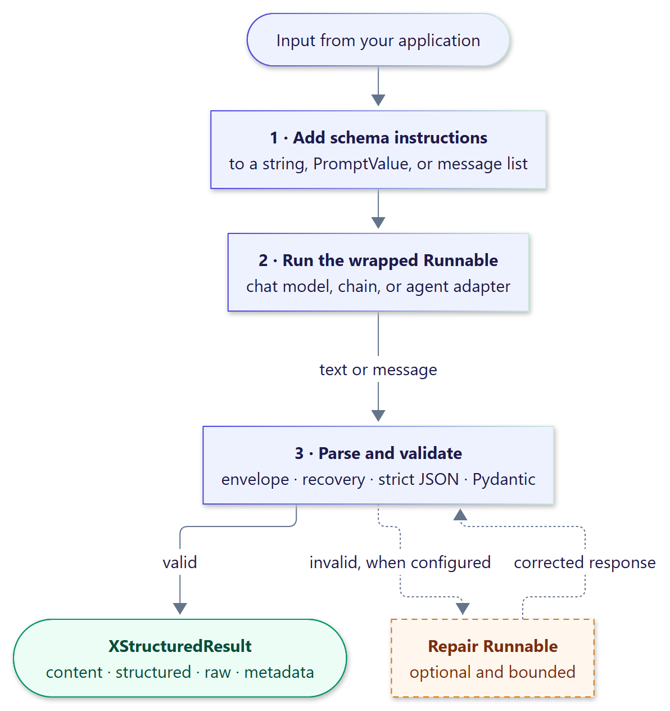

<p align="center">
  
</p>

<h1 align="center">xstructured</h1>

<p align="center">
  <a href="https://github.com/smuniharish/xstructured/actions/workflows/ci.yml"></a>
  <a href="https://xstructured.readthedocs.io/"></a>
  <a href="https://pypi.org/project/xstructured/"></a>
  <a href="https://pypi.org/project/xstructured/"></a>
  
  
  <a href="https://github.com/smuniharish/xstructured/blob/master/LICENSE"></a>
</p>

**Validated Pydantic data _and_ natural-language text from one LLM response.**

xstructured asks the model to answer in its own words and to put a JSON
payload in an envelope. It extracts the payload, validates it with Pydantic v2,
and returns both, even when the payload is wrapped in Markdown, buried in
prose, or still streaming in. It wraps any LangChain v1 Runnable, chat model,
chain, or LangGraph graph, adds middleware to `create_agent` and Deep Agents,
and ends any chain as an output parser.

<p align="center">
  
</p>

## Why xstructured

A support assistant has to explain a decision to the customer while your code
acts on a validated `Decision`. The usual answers fall short:

- **Native structured output returns only the data.** The prose the user
  should read is gone, or needs a second call.
- **Asking for JSON in the prompt is fragile.** Models wrap it in fences, add
  a preamble, or stop halfway, and `json.loads` either fails or accepts a
  truncated payload.
- **Streaming and parsing don't mix.** A UI wants tokens as they arrive; a
  parser wants the whole response.
- **Agents and chains aren't bare chat models.** Rebuilding them around a
  provider feature is costly.

How xstructured addresses each one:

| Problem | What xstructured does |
| --- | --- |
| Only data, no prose | One response carries both: `result.content` for people and `result.structured` for code |
| Fragile prompt-and-parse | Strict JSON decoding and Pydantic validation in JSON mode; recovery only chooses which part of a response to parse and never rewrites JSON |
| Streaming versus parsing | Ordered stream events: text deltas as they arrive, and the validated value the moment its envelope closes |
| Not a bare chat model | Wraps any Runnable or graph, adds middleware to agents, or ends a chain as an output parser |

## Highlights

- **Async first.** `ainvoke`, `abatch`, and `astream` throughout; tracing,
  retries, fallbacks, and composition behave as in any LangChain Runnable.
- **Agents keep their tools.** `XStructuredMiddleware` gives `create_agent`
  and Deep Agents a validated final answer while the agent keeps calling
  tools and writing prose.
- **Bounded by design.** Input, envelope, payload, and nesting limits;
  duplicate keys, `NaN`, and overflowing numbers are rejected before
  validation.
- **Optional, bounded repair.** An opt-in repair Runnable gets a fixed number
  of attempts, and its output is held to the same schema.
- **Multiple and named payloads.** Several values of one schema, or one value
  per named schema, from a single response.
- **Extensible through ABCs.** Every behavior is an abstract base class with
  a default, and `xstructured.testing` ships a contract suite for each.
- **Observable.** An `Observer` sees every call, and `OpenTelemetryObserver`
  turns calls into spans.
- **Small and typed.** The core depends only on `langchain-core` and
  `pydantic`, ships type hints, and is tested on Python 3.12 to 3.15 with
  100% statement and branch coverage.

## Installation

```bash
pip install xstructured                # core: chat models, chains, parsers
pip install "xstructured[agents]"      # with create_agent middleware
```

Optional extras:

| Extra | Adds |
| --- | --- |
| `agents` | LangChain 1.x for `XStructuredMiddleware` and `create_agent` |
| `langgraph` | LangGraph 1.x, to wrap compiled graphs and nodes |
| `deepagents` | Deep Agents, for `create_deep_agent` |
| `otel` | OpenTelemetry API, for `OpenTelemetryObserver` |
| `all` | Every extra above |

## Quickstart

Wrap a chat model, then read the prose and the validated value:

```python
import asyncio

from langchain.chat_models import init_chat_model
from pydantic import BaseModel, Field

from xstructured import with_xstructured_output


class Ticket(BaseModel):
    priority: str = Field(description="low, high, or critical")
    team: str
    summary: str


triage = with_xstructured_output(init_chat_model("openai:gpt-5-mini"), Ticket)


async def main() -> None:
    result = await triage.ainvoke("Checkout is down for every EU customer.")
    print(result.content)  # The model's prose, without the envelope.
    print(result.structured)  # priority='critical' team='payments' ...


asyncio.run(main())
```

Stream the prose to a UI, then render the validated card:

```python
from xstructured import StreamEventKind


async def stream(message: str) -> None:
    async for event in triage.astream(message):
        if event.kind is StreamEventKind.TEXT_DELTA:
            print(event.text, end="")
        elif event.kind is StreamEventKind.STRUCTURED_END:
            print("\nTicket:", event.structured)
```

Give an agent a validated final answer while it keeps its tools:

```python
from langchain.agents import create_agent

from xstructured.agents import XStructuredMiddleware

agent = create_agent(
    "openai:gpt-5-mini",
    tools=[lookup_owner],
    middleware=[XStructuredMiddleware(Ticket)],
)


async def handle(message: str) -> Ticket:
    state = await agent.ainvoke({"messages": [("human", message)]})
    return state["structured_response"].structured
```

Or parse text from any source, without a model:

```python
from xstructured import EnvelopeSpec, StructuredParser

parser = StructuredParser(Ticket, envelope=EnvelopeSpec())
reply = (
    "Escalating now. <xstructured>"
    '{"priority": "critical", "team": "payments", "summary": "EU outage"}'
    "</xstructured>"
)
print(parser.parse(reply).value)
```

The [quickstart](https://xstructured.readthedocs.io/en/latest/getting-started/quickstart/)
covers chains, output parsers, LangGraph, and tests without a provider.

## Customize everything

Every behavior is an abstract base class with a default. Pass your own with
the matching keyword, and check it with its contract in `xstructured.testing`:

| Base class | Keyword | Replace it to |
| --- | --- | --- |
| `InstructionRenderer` | `renderer=` | write the instructions in your own style or language |
| `InstructionInjector` | `injector=` | add the instructions to inputs of your own shape |
| `OutputTextExtractor` | `extractor=` | read the reply from outputs of your own shape |
| `RecoveryStrategy` | `recovery=` | find the payload in a model's quirky output |
| `JsonDecoder` | `decoder=` | accept a model's non-standard JSON |
| `RepairPromptBuilder` | `repair_prompt=` | change what the repair model is asked |
| `Observer` | `observer=` | send metrics and traces to any backend |

The options of the libraries underneath pass straight through, too.
`SchemaOptions` forwards Pydantic's validation (`strict`, `extra`, `context`,
`by_alias`, `by_name`, a `ConfigDict`) and JSON schema generation
(`schema_generator`, `ref_template`, `union_format`). The wrapper is a
LangChain Runnable, so `with_retry`, `with_fallbacks`, `with_config`, and
callbacks work unchanged, and `OpenTelemetryObserver` takes your own
`TracerProvider`. See
[Extension points](https://xstructured.readthedocs.io/en/latest/guide/extension-points/).

## Benchmarks

An offline benchmark runs 11 model-style outputs through four parsers, 1,000
times each, and checks every result against an explicit expectation. A
truncated or ambiguous payload that a parser accepts counts as a failure:

| Mechanism | Correct | Median latency |
| --- | ---: | ---: |
| `json.loads` + Pydantic | 45.45% | 2.00 µs |
| LangChain `JsonOutputParser` + Pydantic | 45.45% | 18.20 µs |
| LangChain `PydanticOutputParser` | 45.45% | 17.70 µs |
| **xstructured** | **100%** | 12.90 µs |

Measured on one machine; see
[Benchmarks](https://xstructured.readthedocs.io/en/latest/benchmarks/) for the
method, per-case results, and how to reproduce.

## Examples

Twelve complete programs in
[`examples/`](https://github.com/smuniharish/xstructured/tree/master/examples).
Each runs offline with a scripted model, or live when `EXPLABS_API_KEY` is
set:

- [Single-agent extraction](https://xstructured.readthedocs.io/en/latest/examples/single-agent-extraction/)
- [Multi-agent pipeline](https://xstructured.readthedocs.io/en/latest/examples/multi-agent-pipeline/)
- [Deep Agents research](https://xstructured.readthedocs.io/en/latest/examples/deep-agent/)
- [LangGraph workflow](https://xstructured.readthedocs.io/en/latest/examples/langgraph-workflow/)
- [RAG with citations](https://xstructured.readthedocs.io/en/latest/examples/rag-citations/)
- [Incident analysis](https://xstructured.readthedocs.io/en/latest/examples/incident-analysis/)
- [Streaming UI events](https://xstructured.readthedocs.io/en/latest/examples/streaming-ui-events/)
- [Multiple payloads and repair](https://xstructured.readthedocs.io/en/latest/examples/multiple-payloads-repair/)
- [Named envelopes](https://xstructured.readthedocs.io/en/latest/examples/named-envelopes/)
- [Output parser chain](https://xstructured.readthedocs.io/en/latest/examples/output-parser-chain/)
- [Customization](https://xstructured.readthedocs.io/en/latest/examples/customization/)
- [OpenTelemetry tracing](https://xstructured.readthedocs.io/en/latest/examples/opentelemetry-tracing/)

## Documentation

Full documentation: **[xstructured.readthedocs.io](https://xstructured.readthedocs.io/)**

- [Getting started](https://xstructured.readthedocs.io/en/latest/getting-started/)
- [User guide](https://xstructured.readthedocs.io/en/latest/guide/)
- [Integrations](https://xstructured.readthedocs.io/en/latest/integrations/)
- [Architecture](https://xstructured.readthedocs.io/en/latest/architecture/)
- [Security](https://xstructured.readthedocs.io/en/latest/security/)
- [API reference](https://xstructured.readthedocs.io/en/latest/api/)

Two [Agent Skills](https://xstructured.readthedocs.io/en/latest/agent-skills/)
teach coding agents such as Claude Code, Codex, Cursor and GitHub Copilot to
use xstructured correctly. `xstructured` adds it to your application, and
`xstructured-extend` writes decoders, recovery strategies, observers, and the
other extension points:

```bash
npx skills add smuniharish/xstructured
```

xstructured follows semantic versioning. Changes are listed in the
[changelog](https://github.com/smuniharish/xstructured/blob/master/CHANGELOG.md).

## Contributing

Contributions are welcome. See
[CONTRIBUTING.md](https://github.com/smuniharish/xstructured/blob/master/CONTRIBUTING.md)
for the development setup and checks, and
[SECURITY.md](https://github.com/smuniharish/xstructured/blob/master/SECURITY.md)
to report a vulnerability.

## License

Apache License 2.0. See
[LICENSE](https://github.com/smuniharish/xstructured/blob/master/LICENSE).
