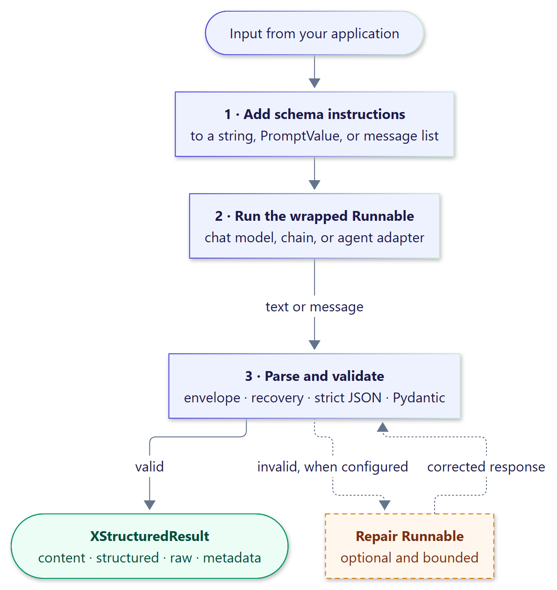
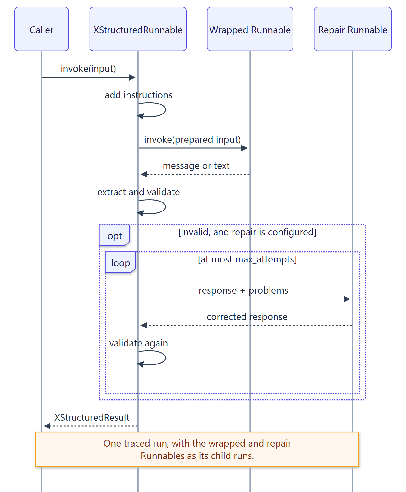

# Architecture

{ .diagram width="596" }

## Components

| Component | Module | Responsibility |
| --- | --- | --- |
| `XStructuredRunnable` | `xstructured.langchain` | Adds instructions, runs the wrapped Runnable as a traced child run, parses, optionally repairs, and builds results. |
| `XStructuredOutputParser` | `xstructured.langchain` | An LCEL output parser that builds the same results from text or messages. |
| `XStructuredMiddleware` | `xstructured.agents` | Agent middleware: adds instructions to the system prompt, validates the final answer, repairs it with the agent's own model, and sets `structured_response`. |
| Extension points | `xstructured.contracts` | Abstract base classes and defaults for instructions, injection, text extraction, recovery, decoding, repair prompts, and observers. |
| `OpenTelemetryObserver` | `xstructured.otel` | One span per call. |
| Testing kit | `xstructured.testing` | `ScriptedChatModel` and contract test suites. |
| `StructuredParser` | `xstructured.parser` | Envelope extraction, conservative recovery, strict JSON, Pydantic validation. |
| `EnvelopeScanner`, `EnvelopeSpec` | `xstructured.envelope` | Incremental, JSON-aware envelope detection. |
| `StreamDecoder` | `xstructured.streaming` | Maps scanner output to ordered `StreamEvent` values; validates on close. |
| Schema helpers | `xstructured.schema` | Introspection, Pydantic options, instructions, named schemas, fingerprints. |
| Configuration, results, errors | `xstructured.core` | Frozen configuration models, result types, the exception hierarchy. |

The core API is exported from the top-level `xstructured` package. The
`agents`, `otel`, and `testing` submodules are imported explicitly, so the core
never loads their optional dependencies.

## Request lifecycle

{ .diagram width="653" }

1. The input is normalized and the schema instructions are added (by the
   `InstructionInjector`, or to the system prompt by the middleware).
2. The wrapped Runnable runs as a child run with the same configuration (callbacks,
   tags, metadata, and recursion limits).
3. The parser locates the envelope, tries the `RecoveryStrategy`'s candidates in
   order, decodes each with the `JsonDecoder`, and validates in Pydantic's JSON mode.
4. If validation fails and repair is configured, the repair Runnable is asked for a
   corrected response, at most `max_attempts` times, and every response is validated by
   the same parser.
5. The result combines the prose, the validated value, the raw output, and metadata,
   and the `Observer`, if any, records the outcome.

Streaming follows the same steps incrementally: the
[stream decoder](guide/streaming.md) validates the payload once, when its envelope closes,
and the final `RESULT` event matches what `ainvoke` would return.

## Design principles

**Validation is the authority.** Recovery only selects a substring of the response and
repair only replaces it; neither ever relaxes the schema.

**Linear, bounded work.** Envelope scanning, string tracking, and nesting checks run as
single compiled-regex passes whose cost grows linearly with input size, and every stage
enforces a configured limit.

**One parse per response.** The schema is introspected once per wrapper, and a streamed
payload is validated exactly once.

**Native LangChain behavior.** The wrapper is a standard Runnable, the parser a
standard output parser, and the middleware a standard agent middleware: they are
traced, they compose, and inside a chain the wrapper emits the same value whether the
chain is invoked or streamed.

**Async first.** Every model call is awaited natively; the sync methods exist for
LangChain compatibility. Extension points are synchronous because they only transform
text in memory.

**Replaceable, not configurable by flags.** Each behavior is an abstract base class
with a default, validated when the entry point is created, and Pydantic's options pass
through unchanged with `SchemaOptions`.

**Explicit failures.** Every failure is a typed `ParseError` subclass carrying the
offending text, and configuration mistakes fail when the parser or wrapper is created.
