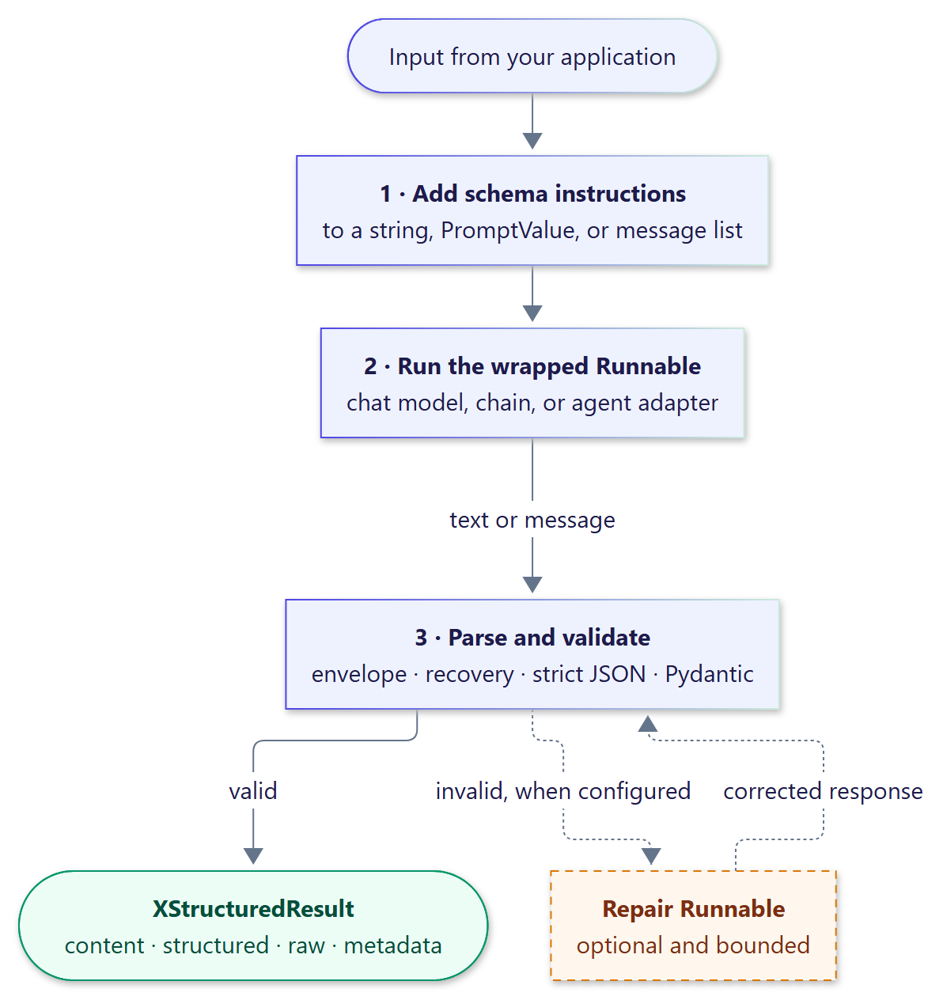
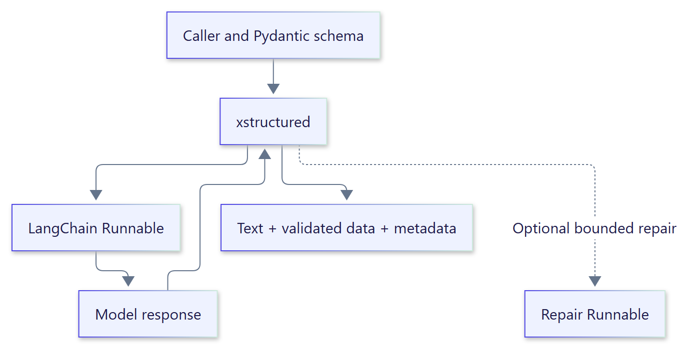

# Architecture

{ .diagram width="596" }

## Components

| Component | Module | Responsibility |
| --- | --- | --- |
| `XStructuredRunnable` | `xstructured.langchain` | Composes a LangChain Runnable with structured instructions and validated results. |
| `XStructuredOutputParser` | `xstructured.langchain` | An LCEL output parser that builds the same results from text or messages. |
| `XStructuredMiddleware` | `xstructured.agents` | Adds the structured response contract to agent output and sets `structured_response`. |
| Extension points | `xstructured.contracts` | Abstract base classes and defaults for instructions, injection, text extraction, recovery, decoding, repair prompts, and observers. |
| `OpenTelemetryObserver` | `xstructured.otel` | One span per call. |
| Testing kit | `xstructured.testing` | `ScriptedChatModel` and contract test suites. |
| `StructuredParser` | `xstructured.parser` | Extracts and validates structured data from a response. |
| `EnvelopeScanner`, `EnvelopeSpec` | `xstructured.envelope` | Incremental, JSON-aware envelope detection. |
| `StreamDecoder` | `xstructured.streaming` | Interprets streamed responses as ordered `StreamEvent` values. |
| Schema helpers | `xstructured.schema` | Introspection, Pydantic options, instructions, named schemas, fingerprints. |
| Configuration, results, errors | `xstructured.core` | Frozen configuration models, result types, the exception hierarchy. |

The core API is exported from the top-level `xstructured` package. The
`agents`, `otel`, and `testing` submodules are imported explicitly, so the core
never loads their optional dependencies.

## Request lifecycle

{ .diagram width="656" }

The wrapper adds schema instructions to the request and runs the supplied
Runnable. It then extracts the response and validates it against the Pydantic
schema. Optional repair can make additional, bounded model calls when validation
fails. The result contains prose, validated data, the raw output, and metadata.
LangChain configuration and callbacks remain available to the wrapped Runnable.

Streaming follows the same steps incrementally: the
[stream decoder](guide/streaming.md) validates the payload once, when its envelope closes,
and the final `RESULT` event matches what `ainvoke` would return.

## Design principles

**Validation is the authority.** Recovery only selects a substring of the response and
repair only replaces it; neither ever relaxes the schema.

**Bounded processing.** Configurable limits constrain untrusted input and
structured payloads.

**Native LangChain behavior.** The wrapper is a standard Runnable, the parser a
standard output parser, and the middleware a standard agent middleware: they are
traced, they compose, and inside a chain the wrapper emits the same value whether the
chain is invoked or streamed.

**Async first.** Every model call is awaited natively; the sync methods exist for
LangChain compatibility. Extension points are synchronous because they only transform
text in memory.

**Replaceable, not configurable by flags.** Each behavior is an abstract base class
with a default, validated when the entry point is created, and Pydantic's options pass
through unchanged with `SchemaOptions`.

**Explicit failures.** Every failure is a typed `ParseError` subclass carrying the
offending text, and configuration mistakes fail when the parser or wrapper is created.
